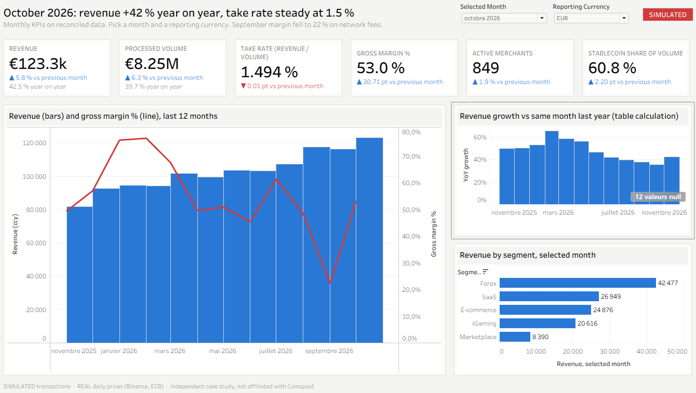
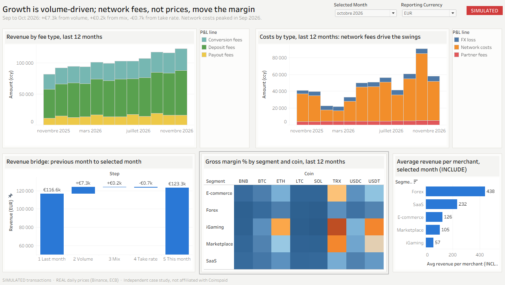
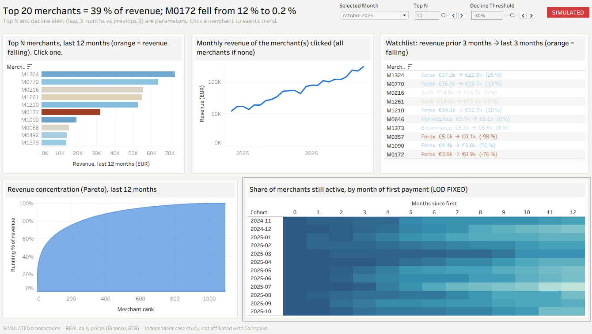
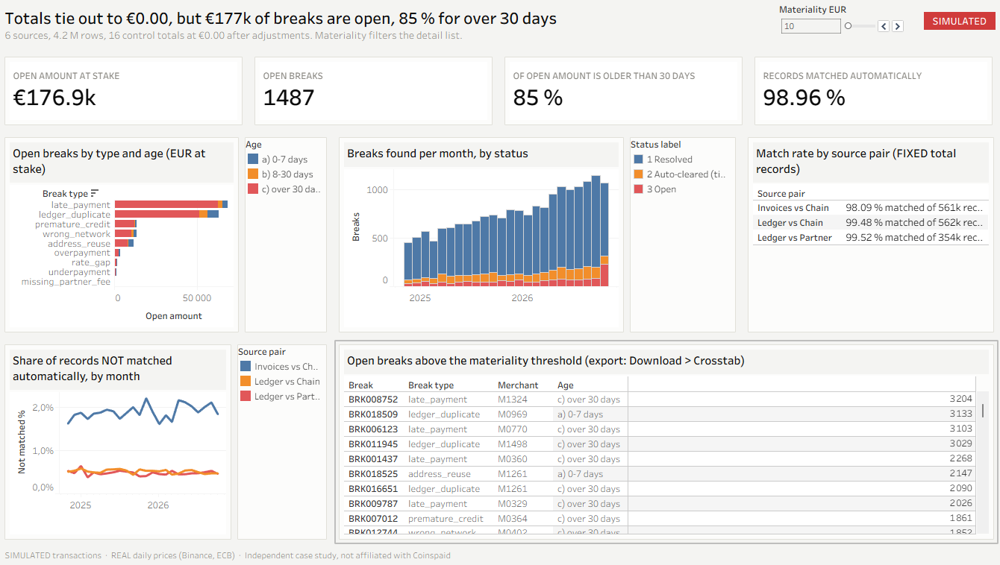
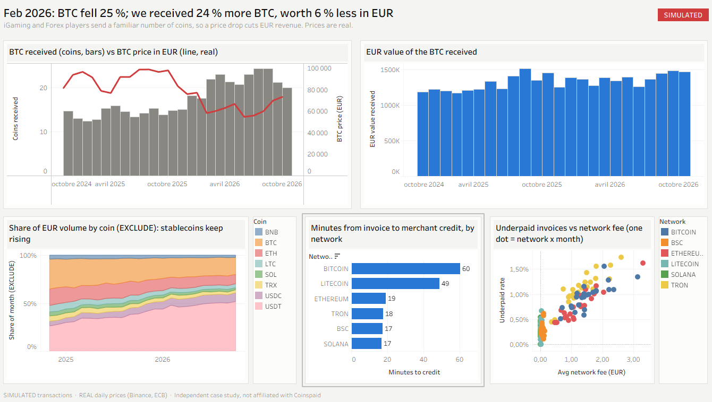

# Crypto payments: reconciled management reporting in Tableau

*Independent case study for a Data & Reporting Analyst role · real market prices, simulated transactions.*

> **SIMULATED transactions · REAL daily prices (Binance, ECB) · Independent case study, not affiliated with Coinspaid.**
> No company or customer data is used. All assumptions are in [`data/ASSUMPTIONS.md`](data/ASSUMPTIONS.md), all sources in [`data/SOURCES.md`](data/SOURCES.md).

**Tableau Public dashboards:** [Crypto Payments Reporting (5 dashboards)](https://public.tableau.com/app/profile/albt/viz/CryptoPaymentsReportingCaseStudy/1Executiveoverview) · local copy: [`tableau/CryptoPaymentsReporting.twbx`](tableau/CryptoPaymentsReporting.twbx) (opens in the free Tableau Public app)
**Excel close pack:** [`excel/Monthly_Close_Pack.xlsx`](excel/Monthly_Close_Pack.xlsx)



---

## The questions, and the answers

A crypto payment gateway gets the same money reported by six systems that never fully agree: the gateway (invoices), the blockchain (explorer), the internal ledger, the exchange partner, the payouts system and the CRM. Management wants one set of numbers it can trust.

| Question | Answer (October 2026, simulated) |
|---|---|
| **Can we trust the numbers?** | Yes, after reconciliation. **All 16 control totals tie out to €0.00 after adjustments.** The pipeline finds **99.4 % of planted breaks with 0 false alarms** (details below). |
| **How is the business doing?** | Revenue **€123.3 k** (+5.8 % MoM, **+42.5 % YoY**) on €8.25 M processed, take rate **1.49 %**, gross margin **53 %**, 849 active merchants, stablecoins **61 %** of volume (45 % a year ago). |
| **Why did revenue move this month?** | Revenue bridge Sep → Oct: **+€7.3 k volume effect**, +€0.2 k mix, **-€0.7 k take-rate effect**. Growth is volume-driven; prices are slowly eroding. |
| **Where does margin go?** | **Network costs.** In September 2026 a fee spike took gross margin down to **22 %** (from 49 %). Network fees are not passed on to merchants. |
| **Which merchants carry revenue, which drop off?** | The top 20 merchants make 39 % of revenue. **M0172 (Forex) went from 12 % of revenue to 0.2 %** between March and October 2026: a "3 months vs previous 3 months below -30 %" alert flags it in June 2026 (-50 %), a monthly view shows the slide from April. New cohorts keep 85 % of merchants after 6 months, 68 % after 12. |
| **What does crypto volatility do to EUR revenue?** | In **February 2026, BTC fell 25 %** (real price). We received **24 % more BTC** than in January, but it was worth **6 % less in EUR**: iGaming and Forex players send a familiar number of coins, not a fixed EUR amount. |
| **What is still open?** | 1,487 breaks, **€177 k at stake; 85 % of that amount is older than 30 days.** Biggest open items: late payments (€69 k) and ledger duplicates (€63 k). |

## Recommendations
1. **Clear the > 30-day backlog** (€151 k) with an owner per break type and a weekly ageing review; write off or escalate after 60 days.
2. **Pass network fees through** (or add a minimum fee) on Bitcoin, USDT-ERC20 and USDT-TRC20: they drive both margin swings and underpayments (1.1 % of TRON invoices are underpaid vs 0.3 % on Solana/BSC).
3. **Block crediting before the required confirmations** (659 premature credits) and **make ledger posting idempotent on tx_hash** (2,238 duplicates).
4. **Watch concentration**: an automatic alert when a top-50 merchant's 3-month revenue drops more than 30 %.
5. **Close the month in UTC**: around 200 partner lines at the October boundaries (€60 k) land in the wrong month if the partner's local date is used.

## What is in this repository

| Deliverable | What it shows |
|---|---|
| **Reconciliation pipeline** (`sql/`, DuckDB) | 4.2 M rows, 6 sources, 9 commented SQL files: cleaning, matching, breaks, KPIs, cohorts, revenue bridge, control totals, validation. Runs in ~10 s. |
| **Excel close pack** (`excel/Monthly_Close_Pack.xlsx`) | Live formulas only: XLOOKUP, INDEX/MATCH, SUMIFS, COUNTIFS, MAXIFS, EDATE; named inputs; structured tables; PivotTables with slicers; P&L; close checklist with drop-downs and automatic checks. |
| **Tableau workbook** (5 dashboards, Tableau Public) | Parameters (month, EUR/USD, Top N, materiality), LOD expressions (FIXED, INCLUDE, EXCLUDE), table calculations, relationships between data sources, dashboard actions. |
| **Validation notebook** (`notebooks/checks.ipynb`) | Precision/recall against planted breaks, control totals, four control charts. |

### The five dashboards (title = the conclusion)
1. **Executive overview**: KPIs for the selected month with MoM / YoY arrows and sparklines.
2. **Revenue & margin**: revenue by fee type, costs, margin by segment and coin, revenue bridge (volume / mix / take rate).
3. **Merchants**: Pareto concentration, cohorts by first-payment month, Top N, decline alerts.
4. **Reconciliation & data quality**: match rate by source and day, breaks by type, amount at stake, ageing, exportable detail.
5. **Crypto mix & volatility**: coin and network mix, EUR vs coin revenue, real prices, time to credit and underpayments by network.

| | |
|---|---|
|  |  |
|  |  |

**Tableau features used** (all defined in [`src/build_tableau.py`](src/build_tableau.py), one line per calculated field):
- **Parameters**: selected month, reporting currency (EUR / USD at the real ECB rate), Top N, decline threshold, materiality.
- **LOD expressions**:
  - `FIXED` first month and cohort size per merchant, 3-month revenue per merchant, records per source pair;
  - `INCLUDE` average revenue per merchant;
  - `EXCLUDE` coin share of the month.
- **Table calculations**: YoY growth (`LOOKUP(…, -12)`), running % for the Pareto (`RUNNING_SUM / TOTAL`), `INDEX()`, revenue-bridge waterfall (`RUNNING_SUM` on a Gantt bar).
- **Filters**: a Top N filter driven by a parameter, inside a **context filter** (last 12 months).
- **Data sources and actions**: six extract-based data sources; a dual axis; a filter action (click a merchant to see its trend).

**How the workbook was built.** The `.twb` is Tableau's XML format. It is written by a Python script (`src/twb.py`, `src/build_tableau.py`), then opened and checked in Tableau Public 2026.3. Tableau Public only saves workbooks built on extracts, so `src/export_tableau.py` writes each table both as a CSV and as a `.hyper` extract (Tableau Hyper API). Every calculated field can be read, changed and rebuilt by hand in Tableau.

## Method

```
merchants (CRM) ─┐
invoices (gateway) ── 02 match: address + network + 7-day window, split payments added up ──┐
chain_tx (explorer) ┘                                                                        │
ledger (internal, UTC) ── 03 match: tx_hash (deposits), ref (conversions, fees), payout_id ──┼─ 04 breaks ─ 05 KPIs ─ 08 controls
partner statements (LOCAL time) ── 01 clean: UTC, network names, hashes, duplicates ─────────┘     06 cohorts
payouts ───────────────────────────────────────────────────────────────────────────────────────── 07 bridge
```

| Step | File | Key idea |
|---|---|---|
| Clean | `01_clean.sql` | Partner local time → UTC (`timezone()`), one network naming standard, EVM hashes lower-cased (Solana hashes are case-sensitive and left alone), duplicates flagged with `ROW_NUMBER()`, never deleted. |
| Invoice ↔ chain | `02_match_invoice_chain.sql` | Same address + network + currency within 7 days. Transfers before expiry are **added up** (split payments), then classed exact / under / over (0.5 % tolerance) / late; unmatched transfers classed wrong network, address reuse or unknown. |
| Ledger ↔ outside | `03_match_ledger.sql` | Deposits vs chain (duplicates, premature credits), conversions vs partner (2 % FX tolerance), partner fees, payouts. |
| Breaks | `04_breaks.sql` | One table: type, source pair, EUR at stake, status (open / resolved / auto-cleared) from ledger evidence (refund, manual credit, reversal, fx_adjustment), age bucket. |
| KPIs | `05_kpis_monthly.sql` | Volume = valid deposits only; revenue = fees; costs = network + partner fees (from the **partner statement**, the ledger misses some) − FX result. |
| Cohorts | `06_merchant_cohorts.sql` | Left-censored merchants (live before the data starts) kept apart; no cell after the last full month (no fake churn). |
| Bridge | `07_revenue_bridge.sql` | ΔR = (V1−V0)·T0 + V1·Σ(w1−w0)·t0 + V1·Σw1·(t1−t0): exact, checked by control C8. |
| Controls | `08_controls.sql` | 16 control totals, residual must be 0.00. |

### Control totals
All control totals tie out to **€0.00** after adjustments (`data/output/controls.csv`).

| Control | Difference | Explained by | Residual |
|---|---:|---|---:|
| C1 Chain receipts vs ledger deposits (8 coins, coin units) | e.g. USDT +11,763.53 | open late / wrong-network / reuse items − open duplicates − open premature credits | 0.00 |
| C2 Partner EUR vs ledger conversions | −€107,173.41 | FX slippage within tolerance + rate gaps | 0.00 |
| C2b Rate gaps vs FX adjustments posted | −€955.77 | open rate gaps | 0.00 |
| C3 Partner fees: statement vs ledger | €29.64 | fees still missing in the ledger | 0.00 |
| C4 Payouts system vs ledger | €0.00 | n/a | 0.00 |
| C5 Oct-2026 cut-off: local vs UTC month | −€5,685.21 | timezone cut-off lines | 0.00 |
| C6 KPI revenue vs ledger fees · C7 network costs · C8 bridge | €0.00 | n/a | 0.00 |

### Validation against planted breaks
The generator plants ~16,800 breaks (plus 1,910 timezone cut-offs) and stores them in a hidden answer key that the pipeline never reads.

| Break type | Planted | Found | Recall | Precision |
|---|---:|---:|---:|---:|
| Underpayment | 4,490 | 4,490 | 100 % | 100 % |
| Late payment | 3,362 | 3,362 | 100 % | 100 % |
| Ledger duplicate | 2,238 | 2,238 | 100 % | 100 % |
| Overpayment | 1,736 | 1,736 | 100 % | 100 % |
| Rate gap | 1,709 | 1,709 | 100 % | 100 % |
| Missing partner fee | 1,495 | 1,381 | **92.4 %** | 100 % |
| Premature credit | 659 | 659 | 100 % | 100 % |
| Wrong network | 625 | 625 | 100 % | 100 % |
| Address reuse | 513 | 513 | 100 % | 100 % |
| Timezone cut-off | 1,910 | 1,910 | 100 % | 100 % |
| **Total** | **18,737** | **18,623** | **99.4 %** | **100 %** |

**The pipeline finds 99.4 % of planted breaks; the 114 missed cases are partner fees booked less than 24 hours late.** The rule flags a fee as "late" only after one day, so a fee booked 5 hours late looks on time. A tighter rule (fee booked after the next daily close) would catch them.

**What validation caught:** the first run found only 98.1 %. Cause: I lower-cased every transaction hash to fix an upper-case legacy connector, but Solana hashes are base58 and case-sensitive, so 243 Solana transfers stopped matching and showed up as both "missed" and "false alarms". Fix: lower-case only `0x…` hashes.

## Limitations
- Transactions are simulated; the patterns (growth, decline, breaks) were planted on purpose, and the pipeline was written knowing which break types exist.
- Daily prices only (no intraday); USDT = 1 USD; network costs allocated to deposits by count.
- The resolution of breaks is inferred from ledger evidence; a real setup would also read a case-management tool.

## How to reproduce
```bash
python -m venv .venv && .venv\Scripts\activate      # Windows
pip install -r requirements.txt
python src/fetch_prices.py      # real prices -> data/raw/prices (optional: the frozen CSV is included)
python src/generate_sim.py      # simulated sources -> data/clean (4.2 M rows, ~15 s)
python src/run_sql.py           # pipeline -> data/recon.duckdb + data/output/*.csv (~10 s)
python src/build_excel.py       # Excel close pack (PivotTables need Excel on Windows)
python src/make_notebook.py     # executes notebooks/checks.ipynb
python src/export_tableau.py    # Tableau-ready CSV + .hyper extracts -> data/output/tableau
python src/build_tableau.py     # tableau/CryptoPaymentsReporting.twb + packaged .twbx
```

Tools: Python (pandas, NumPy), DuckDB SQL, Excel, Tableau Public.

## How this was built
I used Claude Code as a coding assistant, mainly to write the Python scripts faster (data generation, Excel and Tableau builders). The decisions are mine:
- the business questions;
- the data design and assumptions;
- the break types and the reconciliation rules;
- the controls and the validation;
- the conclusions.

I can explain every query, formula and calculated field.

---
*Independent case study, not affiliated with Coinspaid. SIMULATED transactions, REAL daily prices.*
